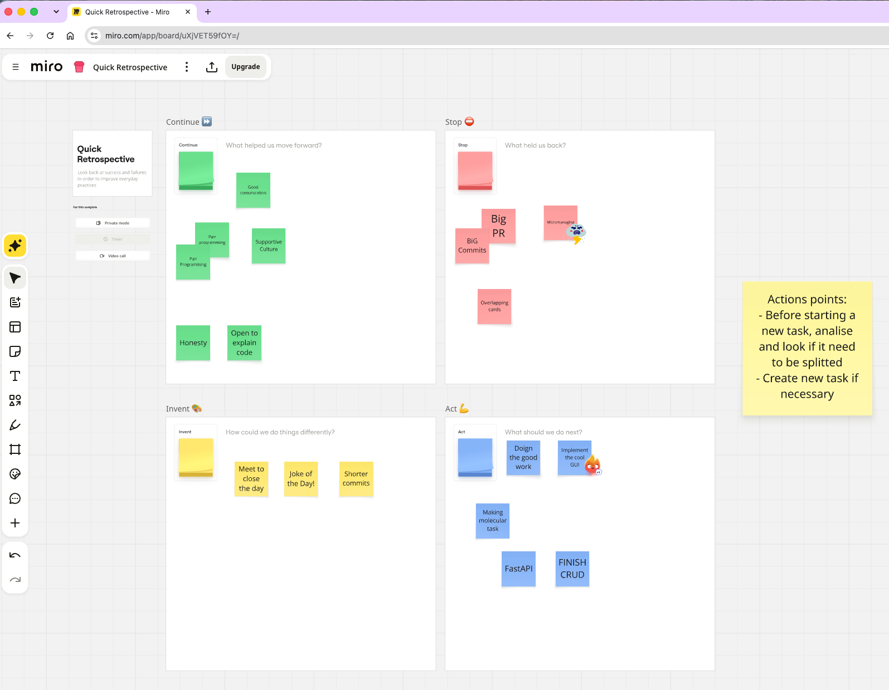

# Retrospective Notes:

## Instruction:

This is a space for the Scrum Master to write a short note about the sprint retrospective. Please add the date and the sprint, then one section for Continue, Stop, Invent, Act, and the action points agreed in the meeting.

## 2026.10.30, Retrospective 1:

We used Miro online to make the activity interactive.

Source: 

### Continue:

Pair programming. Good communication. Supportive culture. Honesty. Open to explain code.

### Stop:

Big PRs. Big commits. Overlapping cards. Micromanaging.

### Invent:

Meet to close the day. Joke of the Day. Shorter commits.

### Act:

Doing the good work. Implement the cool GUI. Making molecular tasks. FastAPI. Finish CRUD.

### Action points:

- Before starting a new task, analyse it and check if it needs to be split.
- Create a new task if necessary.
